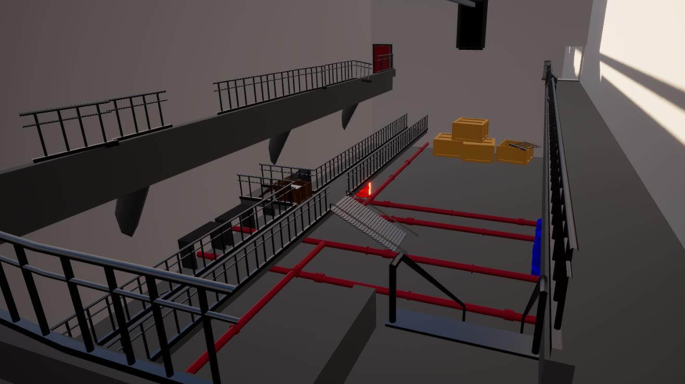
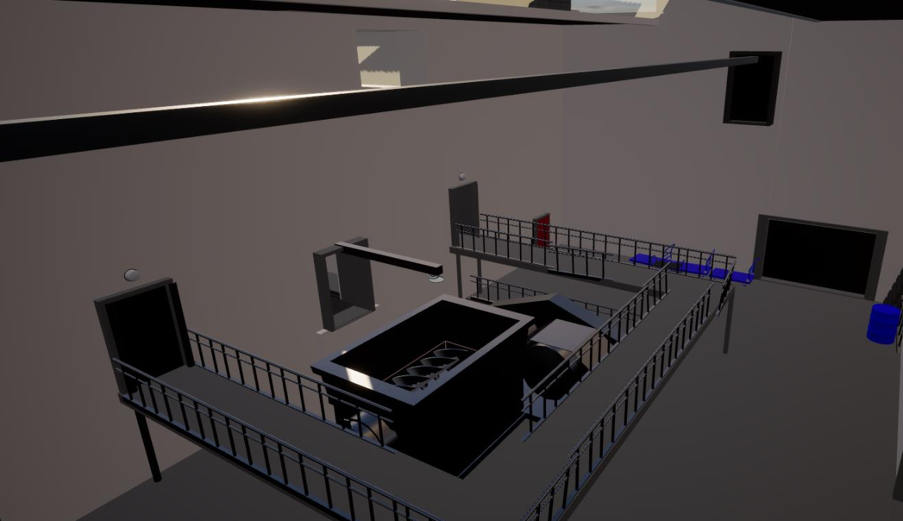
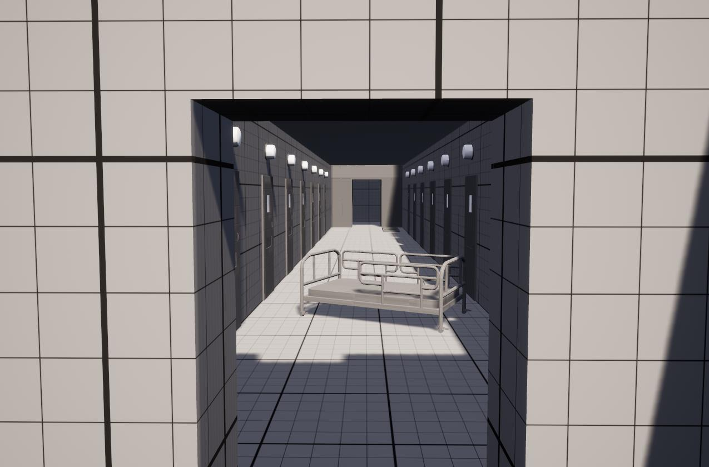
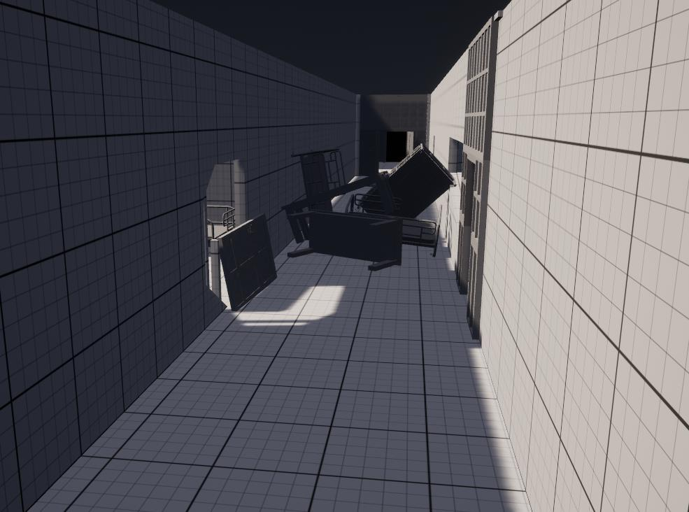
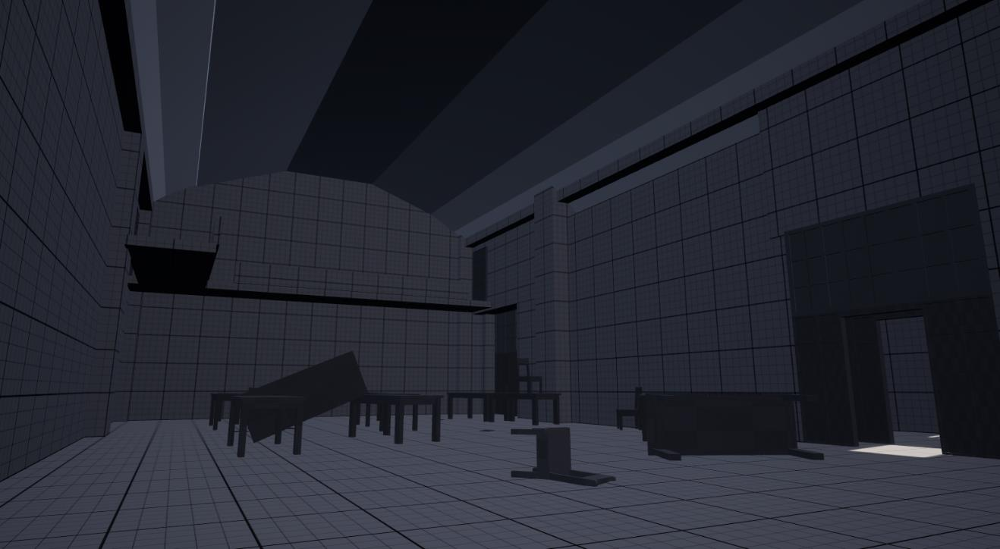

# Maksim Vlasov — Level Designer | Gameplay Programmer

I design levels grounded in real places: every level I build starts from a reference board of photos of real-world locations, which I then turn into a playable blockout.

My background is in gameplay programming, so I'm comfortable scripting the interactions that happen inside a level, and I'm used to working closely with artists and programmers to get a level from blockout to finished space.

- **Level design:** Unreal Engine blockouts, reference boards, prop lists, design documentation
- **Scripting and programming:** C#, GDScript, C++, Blueprint
- **Engines and tools:** Unreal Engine, Unity, Godot, Blender, Substance Painter
- **Shipped projects:** 
- **LinkedIn:** 

---

## BloodDrunk

| Role | Engine | Team | Duration |
|---|---|---|---|
| Level Designer, Design Lead | Unreal Engine | 9 people | ~2.5 months |

A VR arcade wave shooter: you clear waves of thugs any way you like, while a constantly draining blood meter forces you to keep fighting to survive. Released on itch.io for VR platforms.

I was the design lead and spent most of the project designing and blocking out levels and . Two of my levels are in the final game: the **meat processing plant** and the **asylum**. I also built other levels that were cut from the final version.

**My level process**
1. **Gather direction:** asked the team what environments and feelings they wanted in the game, then made a prioritized list of levels together with the other designer, since we knew not all of them would fit in the time we had.
2. **Reference board:** collected photos of real places that matched the rooms and elements I wanted in the level.
3. **Blockout:** built the layout in Unreal Engine, starting from a key room and building outward from it.
4. **Prop list:** gave our 3D artist a "shopping list" of every prop the level needed.
5. **Handoff:** sent the blockout to our environment artist for the art pass.

<!-- TODO: export a slide from one of the shopping list PowerPoints as an image and put it here -->
<!--  -->

### Meat processing plant

The level I'm proudest of, and the one I iterated on most: I rebuilt it twice, because the versions before didn't play the way I wanted.

The first version was heavily inspired by the Slaughterhouse heist from PAYDAY: The Heist, featuring a similar layout and a structure in the middle. When I was planning enemy encounters for this level I realized there was too much back-and-forth since the level was basically a square doughnut. Level felt boring and weird to work with, so I decided to scrap it and try again.

The second version was very close to the final. The flow I initially came up with didn't work well, so I had to change it, keeping some of the rooms and changing the layout.

  

My favorite detail which the level was basically built around on is the conveyor for pig carcasses. It is a prominent theme for the level with the beginning and end - when the level starts, the player sees the start of the line, and has to shoot the enemies with carcasses moving in the way, adding to the challenge; Later, the player goes into a room with a meat grinder, where the carcasses drop into; And finally the player finishes the level in a loading depot, where the meat gets transported from.

There was one important takeaway from making this level: during testing it occurred to me that many players didn't notice the meat grinder where the corpses end up for a couple of reasons: testers were too busy with combat being one, and other being that to actually see the grinder you would have to look to the side or even turn around. It was especially hard to see because of the arcade nature of the game: the player is encouraged to play the game fast, otherwise they will lose. This made me understand that important parts of locations should either be placed in parts of the level where the player will most likely end up looking, or add something that would attract the player to look in its direction, for example an enemy that spawns there, a special effect, directional sound or, ideally, all of the above.

### Asylum

A long level built around cramped corridors. This one I had to do most research on, I even dug up some old real life asylum floor plans to base the level on.

<!-- TODO: 1-2 sentences on what you wanted the player to feel or do here -->

  
  

### What I'd do differently

I didn't draw top-down plans before building; I improvised room by room from the reference board. Playtesters enjoyed the levels, but next time I'd start from a top-down plan, because it makes flow and combat spaces easier to reason about and easier to discuss with the rest of the team.

**Also on this project:** controller haptics, sourcing sounds, recording voice lines, and helping the 3D artist with UV unwrapping and texturing in Substance Painter near the end of the project.

---

## Other work

These projects are covered in more detail in my [gameplay programmer portfolio](TODO_LINK).

- **[Spaceship Cannoneer](https://realkam1.itch.io/spaceship-cannoneer)** (Godot, 4 people, external client): Design lead and the team's contact with the client; wrote all design documentation. Built the holographic tile map the player fights the battle on.
- **[DumbshoW](https://marmonkin.itch.io/dumbshow)** (Godot, 2-person game jam): A single-arena survival game. Co-designed the core mechanics and built the enemy AI and the throwable boxes the player uses to stun enemies and push the deadly mask around the arena.
- **[Strung Flowers](https://sokifin.itch.io/strung-flowers)** (Unity, 10 people): Designed the gameplay loop and enemies together with the team, and wrote all project documentation.

---
